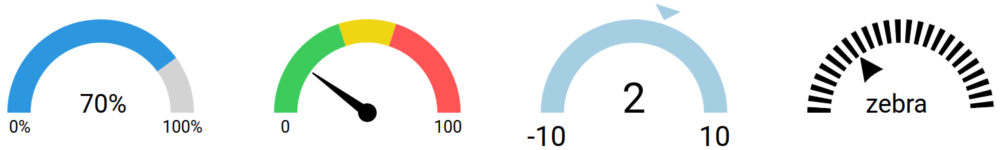

# vue3-gauge

Lightweight gauge / speedometer component for Vue 3.



## Installation

```bash
npm install vue3-gauge
```

## Usage

```vue
<template>
  <VueGauge refid="cpu-gauge" :options="gaugeOptions" />
</template>

<script>
import VueGauge from 'vue3-gauge'

export default {
  components: { VueGauge },
  data() {
    return {
      gaugeOptions: {
        needleValue: 42,
        arcDelimiters: [42],
        rangeLabel: ['0', '100'],
      },
    }
  },
}
</script>
```

Give every gauge on a page its own `refid`.

## Options

| Option | Default | Description |
|---|---|---|
| `needleValue` | `70` | Value the needle points to (0–100) |
| `chartWidth` | `250` | Width in px |
| `hasNeedle` | `true` | Show the needle |
| `needleColor` | `'#f76c57'` | Needle color |
| `needleUpdateSpeed` | `1000` | Needle animation duration in ms |
| `arcColors` | `['#85a3ca', '#d3d3d3']` | Colors of the arc segments |
| `arcDelimiters` | `[70]` | Segment boundaries (0–100) |
| `rangeLabel` | `['0', '100']` | Labels at both ends of the arc |

A plain HTML demo lives in [`demo/index.html`](demo/index.html).
